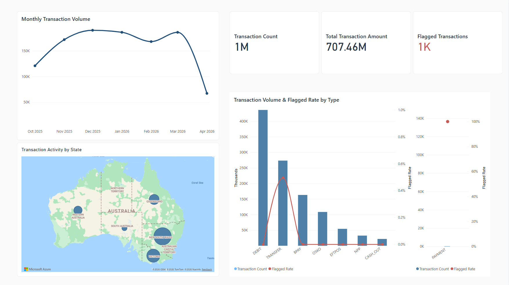

# AMLNet — End-to-end Transaction Monitoring & Account Network Analysis

**Python · Google BigQuery · SQL · Power BI · Deneb/Vega**

A **database-to-dashboard data analysis project** that transforms 1.09 million synthetic financial transactions into an interactive monitoring and investigation tool. The dashboard provides two complementary perspectives: an overview of transaction activity across time, geography, and transaction types, and a focused investigation of potentially suspicious activity at the account and transaction levels. Analysts can examine flagged transactions, especially recent or high-value ones, explore the incoming and outgoing connections of flagged-involved accounts—including their unflagged activity—and inspect the details of individual transactions.

Data-quality assessments were performed before defining the dashboard's analytical scope. Inconsistent merchant identifiers and unreconcilable account balance histories led to the exclusion of unreliable merchant-level and balance-history analyses. The resulting system uses validated data transformations and directed account relationships to support reliable exploration of financial activity.

This workflow supports routine transaction monitoring and focused investigations, providing a reusable analytical interface that could also incorporate the outputs of automated fraud detection, anomaly detection, or risk-scoring systems.

[**Explore Live Dashboard**](https://app.powerbi.com/view?r=eyJrIjoiMDc1ZjIzMGUtMzI1YS00YzZmLTgwNmItMTk5NmIyNWI1N2Y3IiwidCI6IjE2ZGVlZGU4LTc5ZTktNGUzMy05OWU2LTlkOGQzOTQyZDc5NiIsImMiOjEwfQ%3D%3D) · [SQL Scripts] · [Data Quality Assessment]

## 1. Dashboard Overview

### Transaction Overview

The dashboard supports interactive exploration of transaction activity across time, geography, and transaction types. Selecting a month, a location on the map, or a transaction type filters the connected visuals and KPIs, allowing users to compare transaction volumes, amounts, and flagged activity within different subsets of the data.

### Flagged Transactions & Account Connections

The second page provides an account-level investigation workflow:

1. **Discover flagged activity.** Use *Explore Activity* to switch between **Accounts** and **Transactions**, ranking results by recency or amount to identify activity of interest. Alternatively, select an account directly using the Account ID slicer.
2. **Review the selected account.** Account selection updates the network graph and summary KPIs, providing an overview of the account's transaction activity, flagged activity, and connections.
3. **Explore account connections.** The directed network displays aggregated transactions between the selected account and its counterparties, grouped by direction and flagged status. Both flagged and unflagged activity are included, and tooltips reveal the aggregated amounts and transaction directions.
4. **Examine transaction details.** The tables below summarize activity with related accounts and provide individual transaction records. Selecting a counterparty filters the transaction details to examine its interactions with the selected account.

The account selection can be cleared to start another investigation.