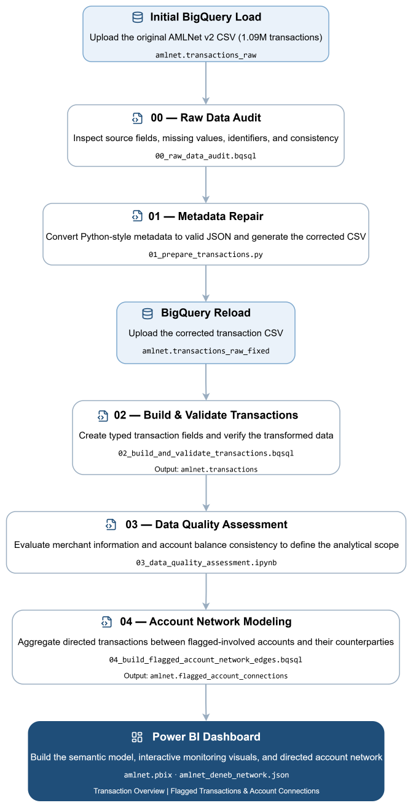

# AMLNet — End-to-end Transaction Monitoring & Account Network Analysis

**Python · BigQuery · SQL · Power BI · Deneb/Vega**

A **database-to-dashboard data analysis project** that transforms 1.09 million synthetic financial transactions ([AMLNet v2 dataset](https://doi.org/10.5281/zenodo.21237971)) into an interactive monitoring and investigation tool. The dashboard provides two complementary perspectives: an overview of transaction activity across time, geography, and transaction types, and a focused investigation of potentially suspicious activity at the account and transaction levels. Analysts can examine flagged transactions, especially recent or high-value ones, explore the incoming and outgoing connections of flagged-involved accounts—including their unflagged activity—and inspect the details of individual transactions.

Data-quality assessments were performed before defining the dashboard's analytical scope. Inconsistent merchant identifiers and unreconcilable account balance histories led to the exclusion of unreliable merchant-level and balance-history analyses. The resulting system uses validated data transformations and directed account relationships to support reliable exploration of financial activity.

This workflow supports routine transaction monitoring and focused investigations, providing a reusable analytical interface that could also incorporate the outputs of automated fraud detection, anomaly detection, or risk-scoring systems.

[Interactive Dashboard](#1-interactive-dashboard) · [Data Quality Assessment & Analytical Decisions](#2-data-quality-assessment--analytical-decisions) · [Data Workflow & Reproduction](#3-data-workflow--reproduction)

## 1. Interactive Dashboard

### Transaction Overview 

[](https://app.powerbi.com/view?r=eyJrIjoiMDc1ZjIzMGUtMzI1YS00YzZmLTgwNmItMTk5NmIyNWI1N2Y3IiwidCI6IjE2ZGVlZGU4LTc5ZTktNGUzMy05OWU2LTlkOGQzOTQyZDc5NiIsImMiOjEwfQ==&pageName=0712ee85a3d537763fc4)

*Click to open the interactive Power BI report.*

The dashboard supports interactive exploration of transaction activity across time, geography, and transaction types. Selecting a month, a location on the map, or a transaction type filters the connected visuals and KPIs, allowing users to compare transaction volumes, amounts, and flagged activity within different subsets of the data.

### Flagged Transactions & Account Connections

[](https://app.powerbi.com/view?r=eyJrIjoiMDc1ZjIzMGUtMzI1YS00YzZmLTgwNmItMTk5NmIyNWI1N2Y3IiwidCI6IjE2ZGVlZGU4LTc5ZTktNGUzMy05OWU2LTlkOGQzOTQyZDc5NiIsImMiOjEwfQ==&pageName=591ea54f0bce5fb5d77d)

*Click to open the interactive Power BI report.*

The second page provides an account-level investigation workflow:

1. **Discover flagged activity.** Use *Explore Activity* to switch between **Accounts** and **Transactions**, ranking results by recency or amount to identify activity of interest. Alternatively, select an account directly using the Account ID slicer.
2. **Review the selected account.** Account selection updates the network graph and summary KPIs, providing an overview of the account's transaction activity, flagged activity, and connections.
3. **Explore account connections.** The directed network displays aggregated transactions between the selected account and its counterparties, grouped by direction and flagged status. Both flagged and unflagged activity are included, and tooltips reveal the aggregated amounts and transaction directions.
4. **Examine transaction details.** The tables below summarize activity with related accounts and provide individual transaction records. Selecting a counterparty filters the transaction details to examine its interactions with the selected account.

The account selection can be cleared to start another investigation.

## 2. Data Quality Assessment & Analytical Decisions

Before defining the dashboard's analytical scope, the dataset was examined to determine whether its merchant information and account balance records could support reliable analysis.

Two areas were investigated: the consistency of merchant identifiers and risk classifications, and whether recorded account balances could be reconciled across successive transactions.

| Assessment                   | Finding                                                      | Decision                                                     |
| ---------------------------- | ------------------------------------------------------------ | ------------------------------------------------------------ |
| Merchant identification      | Only 257 of 293,790 transactions with merchant metadata have matching merchant and destination identifiers. Further checks show a many-to-many relationship between the identifiers. | Exclude merchant-level attribution from the dashboard.       |
| Merchant risk classification | 57 of 1,000 merchant IDs have multiple recorded risk levels, without enough information to explain the changes. | Exclude merchant risk information from the analysis.         |
| Within-transaction balances  | All 1,090,000 transactions satisfy the recorded balance arithmetic within the 0.01 tolerance. | Proceed to test whether account balances remain consistent across time. |
| Account balance histories    | 80.99% of consecutive-observation comparisons and 99.52% of first-anchor comparisons fail temporal reconciliation. | Exclude reconstructed balance histories and balance-derived metrics. |

Therefore, the dashboard focuses on recorded transaction activity and account relationships and excludes merchant profiles or reconstructed balance histories.

**Detailed analysis:** [`03_data_quality_assessment.ipynb`](script/03_data_quality_assessment.ipynb)

## 3. Data Workflow & Reproduction

### Data Workflow

The project uses Google BigQuery as its cloud data warehouse, with Python preprocessing and SQL transformations to prepare the transaction data for analysis and visualization.




Python converts the source metadata from nonstandard dictionary strings into valid JSON ([`01_prepare_transactions.py`](script/01_prepare_transactions.py)), allowing BigQuery to extract structured transaction attributes for analysis. SQL then builds and validates the transaction table ([`02_build_and_validate_transactions.bqsql`](script/02_build_and_validate_transactions.bqsql)). The subsequent data-quality assessment identifies inconsistencies in merchant information and account balances ([`03_data_quality_assessment.ipynb`](script/03_data_quality_assessment.ipynb)), leading to adjustments in the dashboard's analytical scope. For account-level investigation, SQL identifies accounts involved in flagged transactions and retrieves all their transaction activity, including unflagged transfers ([`04_build_flagged_account_network_edges.bqsql`](script/04_build_flagged_account_network_edges.bqsql)). Transactions are grouped by counterparty, direction, and flagged status, so each network edge represents an aggregated financial relationship rather than an individual transaction. A custom **Deneb/Vega** specification ([`amlnet_deneb_network.json`](dashboard/amlnet_deneb_network.json)) renders these relationships as an interactive, force-directed network within Power BI. 

### Repository Structure

```
amlnet-transaction-analysis/
├── dashboard/
│   ├── previews/
│   ├── amlnet.pbix
│   └── amlnet_deneb_network.json
├── data/
│   └── raw/Instruction.md
├── script/
│   ├── 00_raw_data_audit.bqsql
│   ├── 01_prepare_transactions.py
│   ├── 02_build_and_validate_transactions.bqsql
│   ├── 03_data_quality_assessment.ipynb
│   └── 04_build_flagged_account_network_edges.bqsql
├── .gitattributes
├── .gitignore
├── LICENSE
├── README.md
└── workflow.svg
```

### Reproduction

**1. Set up Google Cloud and BigQuery**

Create a BigQuery dataset named `amlnet` in the **EU** multi-region within your Google Cloud project.

Because the source CSV is large, use a Google Cloud Storage bucket in a location compatible with the EU BigQuery dataset for uploading the data.

**2. Upload and audit the original transactions**

Download `AMLNet_v2_transactions.csv` from the [AMLNet v2 dataset](https://doi.org/10.5281/zenodo.21237971), rename it to `transactions.csv`, and upload it to Cloud Storage. In the BigQuery console, select the `amlnet` dataset and choose **Create table**, using the uploaded Cloud Storage file as the source.

- File format: CSV
- Table name: `transactions_raw`
- Header rows to skip: `1`
- Schema: use autodetection and verify the inferred types, particularly that the original `metadata` column is `STRING`

Run `00_raw_data_audit.bqsql` to inspect the source data before preprocessing.

**3. Repair the metadata and reload the CSV**

Place the original CSV at `data/raw/transactions.csv` relative to the project root and execute:

```
python script/01_prepare_transactions.py
```

The script generates `data/processed/transactions_fixed.csv`. Upload this corrected file to Cloud Storage and load it into BigQuery as `amlnet.transactions_raw_fixed`.

Use CSV as the file format, skip the header row, and explicitly define the `metadata` column as **JSON**, preserving the source schema for the remaining columns.

**4. Run SQL scripts and the data-quality notebook**

The `.bqsql` files contain GoogleSQL and can be executed using either method:

- **VS Code:** Install a BigQuery extension that supports `.bqsql`, authenticate with Google Cloud, select the correct project, and execute the queries from the editor.
- **BigQuery web console:** Open a SQL query tab, copy the contents of the `.bqsql` file into the editor, and run the statements.

Execute `02_build_and_validate_transactions.bqsql` to create the cleaned transaction table.

For `03_data_quality_assessment.ipynb`, use Python 3.10+ with Jupyter and install the required packages:

```
pip install jupyter pandas google-cloud-bigquery bigquery-magics
```

If running locally, install the Google Cloud CLI and configure Application Default Credentials:

```
gcloud auth application-default login
```

Open the notebook and, if the project ID is not detected automatically, uncomment and set the following line in its initial configuration cell:

```
bigquery_magics.context.project = "YOUR_PROJECT_ID"
```

Finally, execute `04_build_flagged_account_network_edges.bqsql` to create the account-connection table.

**5. Open and refresh the Power BI dashboard**

Open `amlnet.pbix` in Power BI Desktop. The report already includes its data model, Power Query transformations, measures, visualizations, and interactions. If the Deneb network does not render, install or update Deneb from Power BI AppSource. Update the BigQuery connection credentials and project references as needed, then refresh the data. Verify that both report pages and their interactions work correctly.
